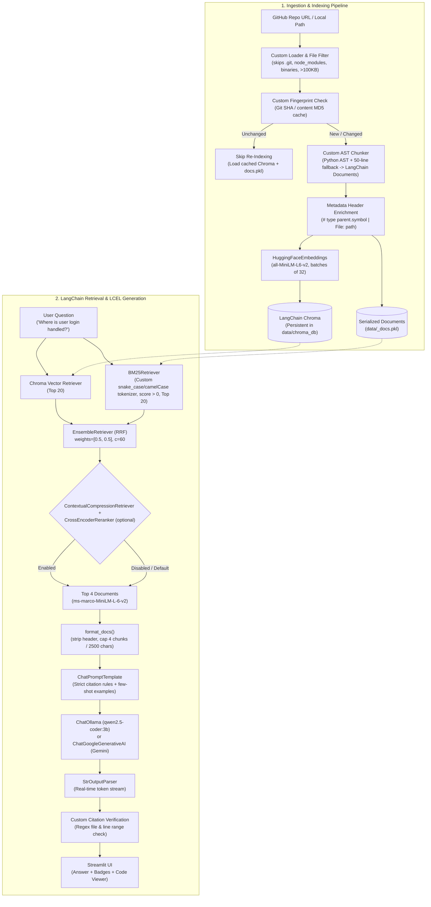

# CodeCompass 🧭

> **Ask your codebase anything. Get answers with file and line citations.**

[](https://www.python.org/)
[](LICENSE)
[](tests/)
[](evaluation/results.md)

Onboarding to an unfamiliar codebase takes time: developers trace function calls, hunt for configuration files, and map request flows across modules. Generic AI code chats often invent file paths or line numbers. **CodeCompass** is a local-first Retrieval-Augmented Generation (RAG) assistant built with **LangChain** and tailored for source code. It parses Python code via AST into LangChain `Document` chunks, indexes them in persistent Chroma and BM25, fuses candidates with `EnsembleRetriever` (Reciprocal Rank Fusion) and an optional `CrossEncoderReranker`, streams grounded answers through an LCEL chain (`ChatOllama` or `ChatGoogleGenerativeAI`), and verifies every cited `file.py:start-end` reference against the retrieved chunks.

*(The earlier manual pre-LangChain implementation is preserved on the git tag `manual-v1`, with its benchmark saved in [`evaluation/results_manual_baseline.md`](evaluation/results_manual_baseline.md).)*

---

## 🏛️ Architecture Overview

CodeCompass runs in two phases: **Ingestion & Indexing** and **LangChain Retrieval & LCEL Generation**.



---

## 📊 Evaluation & Empirical Benchmark

We benchmarked retrieval on **32 ground-truth developer questions** across 7 categories (Architecture, Authentication, Models, Profiles, Articles, Errors, and Configuration) on [`gothinkster/flask-realworld-example-app`](https://github.com/gothinkster/flask-realworld-example-app). Every mode runs a warm-up query before timing so latency reflects steady-state retrieval rather than cold model loading.

### Current LangChain Results ([`evaluation/results.md`](evaluation/results.md))

| Metric | Vector Only | BM25 Only | Hybrid (RRF) | Hybrid + Rerank |
|---|:---:|:---:|:---:|:---:|
| **Hit@1** | 65.6% | 40.6% | 46.9% | **78.1%** |
| **Hit@3** | 87.5% | 62.5% | 78.1% | **90.6%** |
| **Hit@5** | 90.6% | 68.8% | 93.8% | **96.9%** |
| **MRR (Mean Reciprocal Rank)** | 0.7526 | 0.5052 | 0.6505 | **0.8510** |
| **Average Latency (ms)** | 24.8 ms | 1.2 ms | 25.5 ms | 2135.8 ms |

### Category Breakdown (LangChain)

| Category | Metric | Vector Only | BM25 Only | Hybrid (RRF) | Hybrid + Rerank |
|---|---|:---:|:---:|:---:|:---:|
| **Conceptual / Natural Language** *(22 queries)* | **Hit@5** | 86.4% | 54.5% | 90.9% | **95.5%** |
| | **MRR** | 0.7462 | 0.3333 | 0.5371 | **0.8364** |
| **Exact Symbol / Identifier** *(10 queries)* | **Hit@5** | **100.0%** | **100.0%** | **100.0%** | **100.0%** |
| | **MRR** | 0.7667 | 0.8833 | **0.9000** | 0.8833 |

### Comparison Against Manual v1 Baseline ([`evaluation/results_manual_baseline.md`](evaluation/results_manual_baseline.md))

| Mode | Version | Hit@1 | Hit@3 | Hit@5 | MRR | Avg Latency |
|---|---|:---:|:---:|:---:|:---:|:---:|
| **Vector Only** | Manual v1 | 62.5% | 87.5% | 90.6% | 0.7474 | 37.3 ms |
| **Vector Only** | LangChain | **65.6%** | **87.5%** | **90.6%** | **0.7526** | **24.8 ms** |
| **BM25 Only** | Manual v1 | 40.6% | 62.5% | 68.8% | 0.5104 | 1.5 ms |
| **BM25 Only** | LangChain | 40.6% | 62.5% | 68.8% | 0.5052 | **1.2 ms** |
| **Hybrid (RRF)** | Manual v1 | 43.8% | 87.5% | 96.9% | 0.6557 | 39.1 ms |
| **Hybrid (RRF)** | LangChain | **46.9%** | 78.1% | 93.8% | 0.6505 | **25.5 ms** |
| **Hybrid + Rerank** | Manual v1 | 71.9% | 90.6% | 96.9% | 0.8177 | 2587.5 ms |
| **Hybrid + Rerank** | LangChain | **78.1%** | **90.6%** | **96.9%** | **0.8510** | **2135.8 ms** |

### Analysis & Observations

1. **Hybrid (RRF) vs. Vector Only and BM25 Only:**
   - **Hit@5:** Hybrid (RRF) reached **93.8%**, which is higher than Vector Only (90.6%) and BM25 Only (68.8%).
   - **Hit@1 and MRR:** Vector Only had a higher Hit@1 (65.6% vs. 46.9%) and higher MRR (0.7526 vs. 0.6505) than Hybrid (RRF). RRF surfaced more targets inside the top 5, while Vector Only ranked its matches at Rank 1 more often.
2. **Reranker Trade-offs:**
   - **Ranking Precision & Recall:** Hybrid + Rerank achieved the highest Hit@1 (**78.1%**), highest Hit@5 (**96.9%**), and highest MRR (**0.8510**).
   - **Latency:** Hybrid + Rerank also had by far the highest latency (**2135.8 ms** vs. 25.5 ms for Hybrid, 24.8 ms for Vector, and 1.2 ms for BM25).
3. **LangChain vs. Manual v1:**
   - Prepending the metadata header (`# <type> <parent>.<symbol> | File: <path>`) to `Document.page_content` gave Chroma, BM25, and the cross-encoder the same structural signal as Manual v1 while cutting **825 lines of source code** (-27.0%). Vector Only and Hybrid + Rerank improved over Manual v1, while Hybrid (RRF) differed by 1 question on Hit@5 (30/32 vs. 31/32) because all retrievers share one unified `page_content` format rather than separate per-retriever text templates.
4. **Scope and Limits:**
   - These findings are based on 32 questions on a single repository (`flask-realworld-example-app`). Results on larger repositories or other programming languages may differ.

---

## 💡 Key Design Decisions & Interview Talking Points

| Decision | Implementation | Why We Chose It |
|---|---|---|
| **LangChain for standard RAG plumbing** | `Chroma`, `BM25Retriever`, `EnsembleRetriever`, `CrossEncoderReranker`, LCEL (`ChatPromptTemplate \| llm \| StrOutputParser`) | Replaces ~825 lines of boilerplate vector DB, RRF fusion, and HTTP/LLM client wrappers with readable, standard components while keeping the same features. |
| **Custom AST chunker & file loader** | Python `ast` module outputting `Chunk(Document)` | LangChain text splitters do not preserve exact Python function/method/class boundaries, decorators, parent classes, and line numbers as cleanly as an AST walk. |
| **Metadata header in `page_content`** | `add_metadata_header()` + `strip_metadata_header()` | Embedding and scoring raw method bodies loses file path and enclosing class context. Prepending a single comment header during indexing lifted Vector Hit@5 from 84.4% to 90.6% and Rerank MRR from 0.7589 to 0.8510, while stripping it in the UI/prompt keeps displayed code clean. |
| **Identifier-aware BM25 tokenization** | `tokenize_code` passed as `preprocess_func` + zero-score filter | Splits `snake_case` and `camelCase` identifiers while preserving the full symbol, so queries match both `jwt_optional` and `jwt`. Dropping `score <= 0` prevents arbitrary documents from matching out-of-vocabulary queries. |
| **Repo fingerprint caching** | Git SHA or content MD5 in `data/<repo>_meta.json` | Unchanged repositories skip re-embedding and re-indexing immediately. |
| **Custom citation post-verification** | Regex audit in `src/generation/chain.py` | Small 3B models can still hallucinate file paths or line ranges. Regex-checking every cited `file.py:start-end` against retrieved `Document.metadata` catches unverified citations in the UI. |
| **8 GB RAM Windows budget** | Batch size 32, lazy-loaded singletons, max 4 chunks (2,500 chars each), `num_ctx=4096` | Keeps local embeddings, cross-encoder (~80 MB, optional), and `qwen2.5-coder:3b` within 8 GB RAM without crashes. |

---

## ⚠️ Known Limitations & Future Work

1. **Non-Python File Chunking:**
   - Python files use AST parsing, while non-Python files (`.js`, `.ts`, `.go`, `.md`, etc.) use a 50-line overlapping fallback chunker.
   - *Future Work:* Tree-sitter multi-language AST chunking.
2. **Local 3B Model Quality:**
   - `qwen2.5-coder:3b` runs locally on 8 GB RAM, but gives weaker answers and reasoning than larger models. It depends on strict few-shot prompt examples to maintain citation formatting.
   - *Alternative:* Set `LLM_PROVIDER=gemini` and `GEMINI_API_KEY` in `.env` to use Google Gemini via `ChatGoogleGenerativeAI`.
3. **Single-Repository Evaluation Scope:**
   - The benchmark covers 32 questions on one demo repository (`flask-realworld-example-app`). Larger repositories or different languages may show different retrieval numbers.
4. **No Call-Graph Retrieval:**
   - Retrieval uses semantic and lexical similarity rather than static import/call graphs across files.

---

## 🚀 Setup & Installation (Windows Guide)

### Prerequisites

- **Python 3.11+** (tested on Python 3.13)
- **Git**
- **Ollama** installed on Windows ([Download Ollama](https://ollama.com/download/windows))

### 1. Pull the Local Model in Ollama

```powershell
ollama pull qwen2.5-coder:3b
ollama list
```

### 2. Clone & Install Dependencies

```powershell
git clone https://github.com/your-username/codecompass.git
cd codecompass

python -m venv venv
.\venv\Scripts\activate

pip install -r requirements.txt
```

### 3. Configure Environment Variables

```powershell
copy .env.example .env
```

Default `.env` uses local Ollama (`LLM_PROVIDER=ollama`, `LLM_MODEL=qwen2.5-coder:3b`). To switch to Gemini, set `LLM_PROVIDER=gemini` and add `GEMINI_API_KEY` in `.env` (never hardcode API keys).

### 4. Run Tests

```powershell
.\venv\Scripts\python -m pytest -v
```

All **128 tests** pass in under 10 seconds.

### 5. Run the Retrieval Benchmark

```powershell
.\venv\Scripts\python -m evaluation.run_eval --repo flask-realworld-example-app
```

### 6. Launch the Streamlit App

```powershell
.\venv\Scripts\streamlit run app.py
```

Open `http://localhost:8501`, click **⚡ Index Repo**, pick a search mode (`Hybrid`, `Hybrid + Rerank`, `Vector Only`, `BM25 Only`), and ask questions about the codebase.

---

## 📁 Project Structure

```text
codecompass/
├── .env.example                     # Config template (Ollama default + optional Gemini key)
├── .gitignore                       # Ignores venv/, data/, .env
├── requirements.txt                 # LangChain + Chroma + BM25 + Streamlit dependencies
├── PROGRESS.md                      # Development log, migration tracker & LOC summary
├── DEMO_PLAN.md                     # 3-minute interview walkthrough script
├── README.md                        # Documentation & evaluation tables
├── app.py                           # Streamlit UI (indexing, streaming LCEL chat, snippets)
│
├── src/
│   ├── config.py                    # Central .env settings and file filtering constants
│   ├── ingestion/
│   │   ├── loader.py                # Shallow git clone, directory walk & file filtering
│   │   ├── chunker.py               # Python AST chunker + 50-line fallback -> LangChain Documents
│   │   └── indexer.py               # HuggingFaceEmbeddings, LangChain Chroma, docs.pkl & fingerprint cache
│   ├── retrieval/
│   │   └── retrieval.py             # Vector, BM25Retriever (+ tokenizer), EnsembleRetriever, CrossEncoderReranker
│   └── generation/
│       └── chain.py                 # ChatOllama/Gemini, ChatPromptTemplate, LCEL chain & citation verifier
│
├── evaluation/
│   ├── eval_questions.json          # 32 ground-truth questions across 7 categories
│   ├── run_eval.py                  # Warm-up benchmark runner (Hit@k, MRR, latency)
│   ├── results.md                   # Current LangChain evaluation report
│   └── results_manual_baseline.md   # Saved pre-migration manual-v1 baseline report
│
└── tests/
    ├── test_loader.py               # 25 tests — URL parsing, directory/file filters
    ├── test_chunker.py              # 50 tests — AST chunking, fallback chunker, LangChain Document
    ├── test_retrieval.py            # 17 tests — identifier tokenizer, BM25, Ensemble RRF, Rerank & fallback
    ├── test_chain.py                # 15 tests — prompt template, header enrichment, LCEL chain, citations
    ├── test_ui.py                   # 5 tests  — repo name resolution, index check, mode routing
    └── test_evaluation.py           # 16 tests — ground-truth matching, Hit@k, MRR, report generator
```

---

## 📄 License

MIT License. Free for educational and commercial use.
