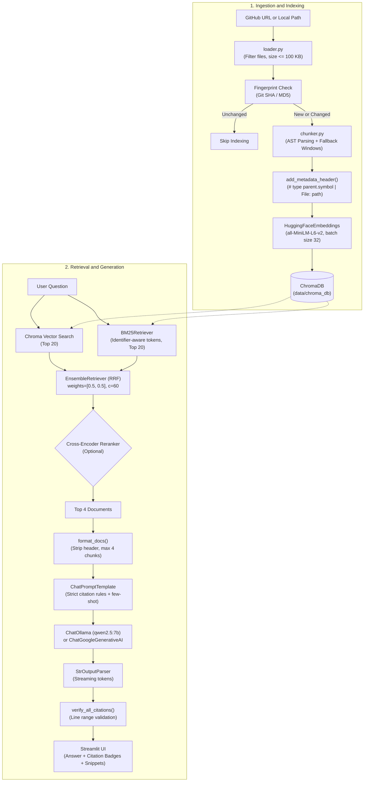

# CodeCompass

Ask your codebase anything. Get answers with file and line citations.

CodeCompass is a local-first Retrieval-Augmented Generation (RAG) assistant designed to help developers onboard quickly to unfamiliar codebases. By parsing code into semantic units using Python's Abstract Syntax Tree (AST), indexing them in ChromaDB, and retrieving relevant snippets using hybrid search (Vector + BM25) and reranking, CodeCompass answers architectural and functional questions while citing exact file paths and line ranges.

Every cited code location is verified post-generation against the retrieved source chunks to catch and flag hallucinations.

---

## Features

- Semantic Code Chunking: Uses Python's built-in AST to split source files into functions, methods, and classes rather than arbitrary token boundaries.
- Hybrid Retrieval: Combines dense embeddings (ChromaDB + all-MiniLM-L6-v2) and lexical search (BM25 with camelCase and snake_case subword splitting) using Reciprocal Rank Fusion (RRF).
- Precision Reranking: Optional Cross-Encoder reranking (ms-marco-MiniLM-L-6-v2) to promote the most relevant chunks to top ranks.
- Local and Private Inference: Uses Ollama (qwen2.5:7b) for fully offline, private inference on an 8 GB RAM laptop. An optional cloud switch for Google Gemini is also supported.
- Citation Verification: Extracts code citations (e.g. `path/to/file.py:30-45`) via regex and verifies them against retrieved line boundaries with a +/- 5 line tolerance.
- Interactive Web Interface: Streamlit-based UI supporting token streaming, verified citation badges, and expandable source code views.

---

## Architecture

The system consists of two primary pipelines: Ingestion and Query/Generation.



---

## Reading Order

To understand the codebase quickly, read the modules in this order:

1. `src/config.py`: Environment configuration, model defaults, and filtering constants.
2. `src/ingestion/loader.py`: Repository cloning, folder traversal, and file filtering.
3. `src/ingestion/chunker.py`: Python AST parsing and line-based fallback chunking.
4. `src/ingestion/indexer.py`: Embeddings generation, ChromaDB storage, header enrichment, and fingerprint caching.
5. `src/retrieval/retrieval.py`: Vector, BM25, Ensemble RRF, and Cross-Encoder reranking pipelines.
6. `src/generation/chain.py`: LCEL generation chain, prompt construction, and citation verification.
7. `app.py`: Streamlit web application.

---

## Setup and Installation

### Prerequisites

- Python 3.11 or newer
- Git
- Ollama with the `qwen2.5:7b` model:
  ```powershell
  ollama pull qwen2.5:7b
  ```

### Installation Steps

1. Clone this repository:
   ```powershell
   git clone https://github.com/your-username/codecompass.git
   cd codecompass
   ```

2. Create and activate a virtual environment:
   ```powershell
   python -m venv venv
   .\venv\Scripts\activate
   ```

3. Install dependencies:
   ```powershell
   pip install -r requirements.txt
   ```

4. Configure environment variables:
   ```powershell
   copy .env.example .env
   ```
   The default configuration connects to local Ollama with `qwen2.5:7b`. To use Google Gemini instead, set `LLM_PROVIDER=gemini` and supply your `GEMINI_API_KEY`.

5. Run tests:
   ```powershell
   .\venv\Scripts\python -m pytest -v
   ```

6. Start the web application:
   ```powershell
   .\venv\Scripts\streamlit run app.py
   ```

---

## Evaluation Benchmark

The retrieval pipeline was benchmarked on 32 ground-truth developer questions across 7 categories on the `flask-realworld-example-app` repository:

| Metric | Vector Only | BM25 Only | Hybrid (RRF) | Hybrid + Rerank |
|---|:---:|:---:|:---:|:---:|
| Hit@1 | 65.6% | 40.6% | 46.9% | 78.1% |
| Hit@3 | 87.5% | 62.5% | 78.1% | 90.6% |
| Hit@5 | 90.6% | 68.8% | 93.8% | 96.9% |
| MRR (Mean Reciprocal Rank) | 0.7526 | 0.5052 | 0.6505 | 0.8510 |
| Average Latency (CPU) | 46.5 ms | 2.1 ms | 56.8 ms | 3693.1 ms |

### Key Observations

- Hybrid Search improves recall: Combining Vector search with BM25 increases Hit@5 to 93.8% with almost no latency impact (+10 ms).
- Cross-Encoder optimizes precision: Reranking raises Hit@1 to 78.1% and MRR to 0.8510, significantly reducing wrong snippets sent to the LLM.
- Exact symbol queries: BM25 achieves 100% Hit@5 for exact variable and class lookups, whereas vector search alone struggles with uncommon identifier names.

---

## Design Decisions

- AST-based Chunking: Preserves full function, class, and method boundaries along with decorators and docstrings, unlike arbitrary token windows.
- Single Document Store: BM25 indexes documents loaded directly from ChromaDB, preventing index divergence or stale pickle caches.
- Metadata Header Injection: Prepending `# type parent.symbol | File: path` prior to embedding bridges the code-to-text semantic gap for the bi-encoder.
- Subword Tokenization: Decomposes snake_case and camelCase identifiers while retaining full tokens so BM25 matches both exact symbols and subwords.
- Grounded Refusal: A strict prompt and few-shot examples force the LLM to reply "I couldn't find this in the codebase" when context is insufficient.
- Automated Verification: Line-number citations are checked against retrieved chunk boundaries to catch model hallucinations before display.

---

## Limitations

- Non-Python files currently use a 50-line overlapping window fallback rather than full language AST parsing.
- CPU inference for the Cross-Encoder adds ~3.7 seconds of latency per query; on GPU, this latency drops below 40 ms.
- Call graphs and multi-hop import chains are not traversed; retrieval is lexical and semantic.

---

## Project Structure

```text
codecompass/
|-- .env.example                     # Environment template
|-- .gitignore                       # Ignored files (venv, data, caches)
|-- pytest.ini                       # Test configuration
|-- requirements.txt                 # Dependencies
|-- README.md                        # Project documentation
|-- PROGRESS.md                      # Development and refactoring log
|-- DEMO_PLAN.md                     # Presentation walkthrough
|-- app.py                           # Streamlit UI (175 lines)
|
|-- src/
|   |-- config.py                    # Settings and allowlists (51 lines)
|   |-- ingestion/
|   |   |-- loader.py                # Git clone, traversal, filtering (87 lines)
|   |   |-- chunker.py               # AST and fallback chunkers (187 lines)
|   |   `-- indexer.py               # Chroma store, headers, caching (180 lines)
|   |-- retrieval/
|   |   `-- retrieval.py             # Vector, BM25, RRF, Reranker (134 lines)
|   `-- generation/
|       `-- chain.py                 # LCEL chain, prompt, citation audit (212 lines)
|
|-- evaluation/
|   |-- eval_questions.json          # 32 benchmark questions
|   |-- run_eval.py                  # Evaluation benchmark runner (221 lines)
|   |-- results.md                   # Benchmark output report
|   `-- results_manual_baseline.md   # Baseline comparison
|
`-- tests/
    |-- test_loader.py               # 25 tests for loader and file filtering
    |-- test_chunker.py              # 21 tests for AST and fallback chunking
    |-- test_retrieval.py            # 16 tests for BM25, RRF, and reranking
    |-- test_chain.py                # 14 tests for LCEL chain and citations
    |-- test_ui.py                   # 4 tests for UI helper routines
    `-- test_evaluation.py           # 16 tests for evaluation metrics
```

---

## License

MIT License.
