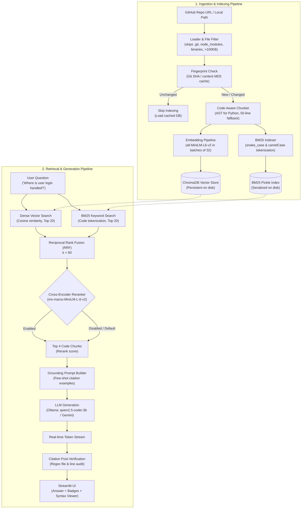

# CodeCompass 🧭

> **Ask your codebase anything. Get answers with file and line citations.**

[](https://www.python.org/)
[](LICENSE)
[](tests/)
[](evaluation/results.md)

Onboarding to a new, unfamiliar codebase is often a frustrating experience. Developers spend hours tracing sprawling function calls, locating config files, and understanding how data flows between architectural layers. Generic AI code chats frequently hallucinate non-existent files or invent methods that do not exist. **CodeCompass** addresses this using an end-to-end Retrieval-Augmented Generation (RAG) system tailored specifically for source code. It parses code into semantic Abstract Syntax Tree (AST) units, indexes them with dense vectors and BM25 keyword matching, fuses candidate rankings using Reciprocal Rank Fusion (RRF), and generates grounded answers citing exact file paths and line ranges (`path/file.py:start-end`) using a local LLM or cloud API.

---

## 🏛️ Architecture Overview

CodeCompass operates in two distinct phases: **Ingestion & Indexing** and **Retrieval & Grounded Generation**.



---

## 📊 Evaluation & Empirical Benchmark

We benchmarked CodeCompass against a ground-truth dataset of **32 developer questions** across 7 core functional areas (Architecture, Authentication, Models, Profiles, Articles, Errors, and Configuration) on the [`gothinkster/flask-realworld-example-app`](https://github.com/gothinkster/flask-realworld-example-app) codebase.

The numbers below are copied directly from the auto-generated evaluation report in [`evaluation/results.md`](evaluation/results.md):

| Metric | Vector Only | BM25 Only | Hybrid (RRF) | Hybrid + Rerank |
|---|:---:|:---:|:---:|:---:|
| **Hit@1** | 62.5% | 40.6% | **43.8%** | **71.9%** |
| **Hit@3** | 87.5% | 62.5% | **87.5%** | **90.6%** |
| **Hit@5** | 90.6% | 68.8% | **96.9%** | **96.9%** |
| **MRR (Mean Reciprocal Rank)** | 0.7474 | 0.5104 | **0.6557** | **0.8177** |
| **Average Latency (ms)** | 37.3 ms | 1.5 ms | 39.1 ms | 2587.5 ms |

### Category Breakdown

| Category | Metric | Vector Only | BM25 Only | Hybrid (RRF) | Hybrid + Rerank |
|---|---|:---:|:---:|:---:|:---:|
| **Conceptual / Natural Language** *(22 queries)* | **Hit@5** | 86.4% | 54.5% | **95.5%** | 95.5% |
| | **MRR** | 0.7008 | 0.3333 | **0.5674** | **0.8333** |
| **Exact Symbol / Identifier** *(10 queries)* | **Hit@5** | 100.0% | 100.0% | **100.0%** | 100.0% |
| | **MRR** | 0.8500 | **0.9000** | 0.8500 | 0.7833 |

### Analysis & Observations

1. **Hybrid vs. Vector Only:**
   - **Hit@5:** Hybrid retrieval achieved a higher Hit@5 (**96.9%**) than Vector Only (90.6%) and BM25 Only (68.8%). Combining dense and sparse retrieval helped surface target files that vector search missed (such as configuration classes).
   - **Hit@1 and MRR:** However, Vector Only had a higher Hit@1 (62.5% vs. 43.8%) and higher MRR (0.7474 vs. 0.6557) than Hybrid. Reciprocal Rank Fusion frequently placed the correct chunk within the top 3 to 5 results, but vector search placed it directly at Rank 1 more often when it matched.
2. **Reranker Trade-offs:**
   - **Ranking Precision:** Hybrid + Rerank achieved the highest MRR (**0.8177**) and the highest Hit@1 (**71.9%**), successfully placing target snippets at Rank 1 in most queries.
   - **Latency:** It also had by far the highest latency (**2587.5 ms** vs. 39.1 ms for Hybrid and 37.3 ms for Vector).
3. **Scope and Limits:**
   - These findings are based on a small evaluation set of 32 questions on a single repository (`flask-realworld-example-app`). Results on larger codebases or other programming languages may differ.

---

## 💡 Key Design Decisions & Interview Talking Points

| Decision | Implementation | Why We Chose It (Interview Rationale) |
|---|---|---|
| **AST Chunking** | Python `ast` module | Fixed-size token windows break code at arbitrary lines, severing function signatures from their bodies. AST chunking guarantees every chunk represents a coherent semantic unit (function, method, class) with exact line boundaries. |
| **Code Tokenization** | Regex subword split | Standard NLP tokenizers treat `get_user_by_id` as an opaque token. Our tokenizer preserves the compound token while indexing constituent parts (`get`, `user`, `id`), allowing BM25 to match both exact symbols and partial subwords. |
| **Rank Fusion (RRF)** | $1 / (60 + \text{rank})$ | Dense vector cosine scores ($[0, 1]$) and BM25 scores ($[0, \infty)$) live on incompatible mathematical scales. RRF operates solely on rank position, avoiding fragile score normalization or hyperparameter tuning. |
| **Memory Consciousness** | 8 GB RAM target | Embeddings are calculated in batches of 32 chunks; embedding and cross-encoder models are singletons lazy-loaded on demand; ChromaDB runs in-process on disk. Peak memory usage remains under 1.5 GB. |
| **Post-Citation Verification** | Regex audit engine | Small local models (3B) occasionally generate plausible-sounding hallucinated line numbers. CodeCompass intercepts generated text, regex-extracts citations, and checks them against retrieved AST metadata, displaying verified badges in the UI. |
| **Provider Agnostic LLM** | `LLMProvider` ABC | All generation logic is decoupled behind an abstract base class. CodeCompass defaults to local Ollama (`qwen2.5-coder:3b`), but supports Google Gemini API with a single `.env` setting for zero-cost cloud hosting. |

---

## ⚠️ Known Limitations & Future Work

While CodeCompass performs well on the demo repository, real-world codebases present additional challenges:

1. **Non-Python File Chunking:**
   - While Python files use full AST parsing, non-Python files (`.js`, `.ts`, `.go`, `.md`) fall back to fixed 50-line overlapping windows.
   - *Future Work:* Integrate Tree-sitter for multi-language AST chunking across TypeScript, Go, Rust, and Java.
2. **Local 3B Parameter Model Capacity:**
   - `qwen2.5-coder:3b` is lightweight and runs fast on consumer RAM, but its multi-step reasoning is weaker than larger 14B/32B models or frontier cloud LLMs. It relies heavily on strict few-shot examples in the prompt to adhere to citation formats.
   - *Alternative:* Switch to `LLM_PROVIDER=gemini` in `.env` to leverage larger frontier models with no local hardware overhead.
3. **Single Repository Evaluation Scope:**
   - The quantitative benchmark was evaluated against 32 questions on a single target repository (`flask-realworld-example-app`). Performance on massive repositories (>100,000 files) would require distributed vector storage and hierarchical indexing.
4. **Static vs Call-Graph Retrieval:**
   - Retrieval is currently lexical and semantic. It does not trace AST import graphs or call graphs (e.g., following caller-callee chains across files).
   - *Future Work:* Construct an in-memory symbol call graph to retrieve caller/callee contexts alongside search chunks.

---

## 🚀 Setup & Installation (Windows Guide)

### Prerequisites

- **Python 3.11+** (tested on Python 3.13)
- **Git**
- **Ollama** installed on Windows ([Download Ollama](https://ollama.com/download/windows))

### 1. Set Up Ollama & Pull the Model

Open PowerShell and start Ollama, then pull the code model:

```powershell
ollama pull qwen2.5-coder:3b
```

Verify that Ollama is running:
```powershell
ollama list
```

---

### 2. Clone Repository & Setup Virtual Environment

```powershell
# Clone this repository
git clone https://github.com/your-username/codecompass.git
cd codecompass

# Create virtual environment
python -m venv venv

# Activate virtual environment
.\venv\Scripts\activate

# Install dependencies
pip install -r requirements.txt
```

---

### 3. Configure Environment Variables

Copy the example configuration file:

```powershell
copy .env.example .env
```

Review `.env`. By default, it is configured for local Ollama:
```ini
LLM_PROVIDER=ollama
LLM_MODEL=qwen2.5-coder:3b
OLLAMA_BASE_URL=http://localhost:11434
EMBEDDING_MODEL=all-MiniLM-L6-v2
RERANKER_MODEL=cross-encoder/ms-marco-MiniLM-L-6-v2
```

*(Optional: To use Google Gemini instead of Ollama, set `LLM_PROVIDER=gemini` and add your free `GEMINI_API_KEY` from Google AI Studio).*

---

### 4. Run the Test Suite

Execute the full pytest suite (138 unit & integration tests):

```powershell
pytest tests/ -v
```

All 138 tests should pass in under 6 seconds:
```text
============================= 138 passed in 5.82s =============================
```

---

### 5. Run the Retrieval Benchmark

To reproduce the benchmark evaluation numbers:

```powershell
python -m evaluation.run_eval --repo flask-realworld-example-app
```

The script evaluates all 32 questions and generates an updated `evaluation/results.md`.

---

### 6. Launch the Streamlit Web Application

Start the web UI:

```powershell
streamlit run app.py
```

The application will launch in your browser at `http://localhost:8501`.

1. Paste a GitHub URL (or keep the default `data/flask-realworld-example-app`).
2. Click **⚡ Index Repo** (cached automatically if unchanged).
3. Select your retrieval mode (Hybrid RRF, Hybrid + Rerank, Vector Only, BM25 Only).
4. Ask any question and inspect the streamed answer, verified citation badges, and syntax-highlighted code snippets!

---

## 🧪 Project Structure

```text
codecompass/
├── .env.example                  # Template showing all config keys
├── .gitignore                    # Ignores venv/, data/, .env, etc.
├── requirements.txt              # Python dependencies
├── PROGRESS.md                   # Complete phase progress & development tracker
├── DEMO_PLAN.md                  # 3-minute interview demo script & presentation guide
├── README.md                     # Documentation & evaluation report
├── app.py                        # Streamlit web UI (streaming chat, snippets, mode toggle)
│
├── src/
│   ├── config.py                 # Central configuration and file filtering constants
│   ├── ingestion/
│   │   ├── loader.py             # Shallow cloning, directory traversal & file filtering
│   │   ├── chunker.py            # AST function/class extraction + 50-line fallback
│   │   └── indexer.py            # Batch embeddings, ChromaDB + BM25 indexing & caching
│   ├── retrieval/
│   │   ├── vector_search.py      # ChromaDB cosine similarity search
│   │   ├── keyword_search.py     # BM25Okapi with identifier-aware tokenization
│   │   ├── hybrid.py             # Reciprocal Rank Fusion (RRF, k=60)
│   │   └── reranker.py           # Cross-Encoder (ms-marco-MiniLM-L-6-v2) reranker
│   └── generation/
│       ├── llm.py                # Provider-agnostic interface (Ollama + Gemini REST)
│       ├── prompts.py            # Grounding prompt templates with few-shot citations
│       └── answerer.py           # End-to-end RAG pipeline + citation regex verifier
│
├── evaluation/
│   ├── eval_questions.json       # 32 ground-truth benchmark questions across 7 categories
│   ├── run_eval.py               # Benchmark runner computing Hit@k, MRR & latency
│   └── results.md                # Quantitative evaluation report
│
└── tests/
    ├── test_loader.py            # 25 tests for loader, URL parsing, file filters
    ├── test_chunker.py           # 49 tests for AST chunking, docstrings, decorators
    ├── test_hybrid.py            # 19 tests for identifier splitting, BM25 & RRF math
    ├── test_generation.py        # 13 tests for prompts, citation regex & mock LLM
    ├── test_ui.py                # 5 tests for UI helpers, routing & index checks
    ├── test_evaluation.py        # 15 tests for ground-truth matching & IR metrics
    └── test_reranker.py          # 12 tests for reranker, caching & Gemini provider
```

---

## 📄 License

MIT License. Free for educational and commercial use.

