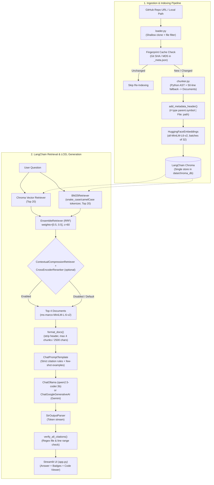

# CodeCompass 🧭

> **Ask your codebase anything. Get answers with file and line citations.**

[](https://www.python.org/)
[](LICENSE)
[](tests/)
[](evaluation/results.md)

Onboarding to an unfamiliar codebase takes time: developers trace function calls, hunt for configuration files, and map request flows across modules. Generic AI code chats often invent file paths or line numbers. **CodeCompass** is a compact, local-first Retrieval-Augmented Generation (RAG) assistant built with **LangChain** (~1,058 lines across 7 Python modules). It parses Python code via AST into LangChain `Document` chunks, indexes them in persistent Chroma, combines dense embeddings and identifier-aware BM25 with `EnsembleRetriever` (Reciprocal Rank Fusion) and an optional `CrossEncoderReranker`, streams grounded answers through an LCEL pipeline (`ChatOllama` or `ChatGoogleGenerativeAI`), and regex-verifies every cited `file.py:start-end` reference against the retrieved chunks.

---

## 📖 Reading Order (How a Question Flows Through the Code)

Start here to read the entire codebase in 15 minutes:

1. [`src/config.py`](src/config.py) *(69 lines)* — All `.env` settings, model names, retrieval limits (`TOP_K_RETRIEVAL=20`, `TOP_K_FINAL=4`), and file-filtering rules.
2. [`src/ingestion/loader.py`](src/ingestion/loader.py) *(88 lines)* — Shallow-clones a GitHub URL (or opens a local folder) and filters out junk dirs, binaries, lock files, and files over 100 KB.
3. [`src/ingestion/chunker.py`](src/ingestion/chunker.py) *(187 lines)* — Parses `.py` files with Python's `ast` module into function/method/class/module LangChain `Document` objects (50-line overlapping fallback for other file types).
4. [`src/ingestion/indexer.py`](src/ingestion/indexer.py) *(182 lines)* — Prepends a compact metadata header (`# <type> <parent>.<symbol> | File: <path>`), embeds chunks in batches of 32 into persistent LangChain `Chroma`, caches repo fingerprints in `data/<repo>_meta.json`, and loads `Document` objects back from Chroma for BM25.
5. [`src/retrieval/retrieval.py`](src/retrieval/retrieval.py) *(137 lines)* — Builds all 4 LangChain retrievers behind `get_retriever()`: `Chroma` vector search, `BM25Retriever` (with custom `snake_case`/`camelCase` tokenization), `EnsembleRetriever` (RRF, equal weights, `c=60`), and optional `CrossEncoderReranker`.
6. [`src/generation/chain.py`](src/generation/chain.py) *(217 lines)* — Wires the LCEL pipeline (`retriever | format_docs | ChatPromptTemplate | ChatOllama/ChatGoogleGenerativeAI | StrOutputParser`) with token streaming, grounded refusal, and regex citation verification (`verify_all_citations()`).
7. [`app.py`](app.py) *(174 lines)* — Streamlit UI tying everything together: repo indexing, provider & search-mode selection, live streaming chat, verified citation badges, and expandable source code snippets.

**Trace of a single question:**
`app.py` (`st.chat_input`) → `get_retriever()` in `retrieval.py` → `stream_answer()` in `chain.py` (`retriever.invoke()` fetches up to 4 `Document` chunks → `format_docs()` strips synthetic headers and caps chunk length → `ChatPromptTemplate | ChatModel | StrOutputParser` streams tokens) → `verify_all_citations()` checks every cited `file:start-end` against retrieved `Document.metadata` → `app.py` displays badges + syntax-highlighted snippets.

---

## 🏛️ Architecture Overview



---

## 📊 Evaluation Benchmark

Benchmarked on **32 ground-truth developer questions** across 7 categories (Architecture, Authentication, Models, Profiles, Articles, Errors, and Configuration) on [`gothinkster/flask-realworld-example-app`](https://github.com/gothinkster/flask-realworld-example-app). Every mode runs a warm-up query before timing so latency reflects steady-state retrieval. Numbers are copied verbatim from [`evaluation/results.md`](evaluation/results.md):

| Metric | Vector Only | BM25 Only | Hybrid (RRF) | Hybrid + Rerank |
|---|:---:|:---:|:---:|:---:|
| **Hit@1** | 65.6% | 40.6% | 46.9% | **78.1%** |
| **Hit@3** | 87.5% | 62.5% | 78.1% | **90.6%** |
| **Hit@5** | 90.6% | 68.8% | 93.8% | **96.9%** |
| **MRR (Mean Reciprocal Rank)** | 0.7526 | 0.5052 | 0.6505 | **0.8510** |
| **Average Latency (ms)** | 46.5 ms | 2.1 ms | 56.8 ms | 3693.1 ms |

### Category Breakdown

| Category | Metric | Vector Only | BM25 Only | Hybrid (RRF) | Hybrid + Rerank |
|---|---|:---:|:---:|:---:|:---:|
| **Conceptual / Natural Language** *(22 queries)* | **Hit@5** | 86.4% | 54.5% | 90.9% | **95.5%** |
| | **MRR** | 0.7462 | 0.3333 | 0.5371 | **0.8364** |
| **Exact Symbol / Identifier** *(10 queries)* | **Hit@5** | **100.0%** | **100.0%** | **100.0%** | **100.0%** |
| | **MRR** | 0.7667 | 0.8833 | **0.9000** | 0.8833 |

### Analysis & Observations

1. **Hybrid (RRF) vs. Vector Only and BM25 Only:** Hybrid (RRF) reached **93.8% Hit@5**, higher than Vector Only (90.6%) and BM25 Only (68.8%), while Vector Only had higher Hit@1 (65.6% vs. 46.9%) and MRR (0.7526 vs. 0.6505).
2. **Reranker Trade-offs:** Hybrid + Rerank achieved the highest Hit@1 (**78.1%**), Hit@5 (**96.9%**), and MRR (**0.8510**), at the cost of the highest CPU latency (**3693.1 ms** vs. 56.8 ms for Hybrid, 46.5 ms for Vector, and 2.1 ms for BM25).
3. **Scope and Limits:** These results come from 32 questions on a single repository (`flask-realworld-example-app`); larger repositories or other languages may behave differently.

---

## 💡 Key Design Decisions

| Decision | Implementation | Rationale |
|---|---|---|
| **LangChain components & LCEL** | `Chroma`, `BM25Retriever`, `EnsembleRetriever`, `CrossEncoderReranker`, `ChatPromptTemplate \| llm \| StrOutputParser` | Keeps the entire app under ~1,060 lines of readable code instead of maintaining custom vector DB, RRF, and HTTP client wrappers. |
| **Single document store (Chroma)** | `load_documents()` reads `Document` objects directly from Chroma for `BM25Retriever` | Eliminates duplicate `.pkl` indexes and keeps Vector + BM25 guaranteed in sync. |
| **Custom Python AST chunker** | Python `ast` outputting plain LangChain `Document` objects | Preserves complete function/method/class units, decorators, parent class, and exact line ranges. |
| **Metadata header enrichment** | `add_metadata_header()` at index time, `strip_metadata_header()` in UI/prompts | Gives embeddings, BM25, and the cross-encoder file/class/symbol context while keeping displayed code clean and metadata line numbers exact. |
| **Identifier-aware BM25 tokenization** | `tokenize_code` passed as `preprocess_func` | Splits `snake_case` and `camelCase` identifiers while retaining full tokens so queries match both exact symbols and subwords. |
| **Repo fingerprint caching** | Git HEAD SHA or content MD5 in `data/<repo>_meta.json` | Unchanged repositories skip re-embedding immediately without loading the embedding model. |
| **Post-generation citation audit** | Regex check in `verify_all_citations()` | Catches unverified file paths or line ranges produced by smaller 3B models. |
| **8 GB RAM Windows budget** | Batch size 32, lazy singletons, max 4 chunks (2,500 chars each), `num_ctx=4096` | Runs comfortably on an 8 GB RAM laptop with local Ollama (`qwen2.5-coder:3b`) or optional Gemini via `.env`. |

---

## ⚠️ Known Limitations

1. **Non-Python files use the fallback chunker:** Only `.py` files use AST parsing; other file types (`.js`, `.ts`, `.go`, `.md`, etc.) use 50-line overlapping windows.
2. **Local 3B model capacity:** `qwen2.5-coder:3b` fits in 8 GB RAM but produces weaker answers than larger models and relies on few-shot prompt examples for citation discipline. Set `LLM_PROVIDER=gemini` and `GEMINI_API_KEY` in `.env` to use Gemini instead.
3. **Single demo repository evaluation:** The benchmark covers 32 questions on one repository (`flask-realworld-example-app`).
4. **No call-graph traversal:** Retrieval uses semantic and lexical matching rather than cross-file call/import graphs.

---

## 🚀 Setup & Installation (Windows)

```powershell
# 1. Pull the local Ollama model
ollama pull qwen2.5-coder:3b

# 2. Clone & install dependencies
git clone https://github.com/your-username/codecompass.git
cd codecompass
python -m venv venv
.\venv\Scripts\activate
pip install -r requirements.txt

# 3. Configure .env (uses local Ollama by default; optionally set LLM_PROVIDER=gemini + GEMINI_API_KEY)
copy .env.example .env

# 4. Run all 97 tests
.\venv\Scripts\python -m pytest -v

# 5. Re-run the 32-question retrieval benchmark (optional)
.\venv\Scripts\python -m evaluation.run_eval --repo flask-realworld-example-app

# 6. Launch the Streamlit app
.\venv\Scripts\streamlit run app.py
```

---

## 📁 Project Structure

```text
codecompass/
├── .env.example                     # Configuration template (Ollama default + optional Gemini key)
├── .gitignore                       # Ignores venv/, data/, .env, caches
├── pytest.ini                       # Pytest configuration
├── requirements.txt                 # Minimal LangChain, Chroma, BM25, and Streamlit dependencies
├── README.md                        # Project overview, reading order, architecture, and benchmark
├── PROGRESS.md                      # Current module summary, test breakdown, and LOC report
├── DEMO_PLAN.md                     # 3-minute interview walkthrough script
├── app.py                           # Streamlit UI: repo indexing, streaming chat, citations, code viewer (174 lines)
│
├── src/
│   ├── config.py                    # .env settings, model defaults, and file filtering constants (69 lines)
│   ├── ingestion/
│   │   ├── loader.py                # Shallow git clone, directory walk, and file filtering (88 lines)
│   │   ├── chunker.py               # Python AST + 50-line fallback chunker returning Documents (187 lines)
│   │   └── indexer.py               # Embeddings, Chroma storage, metadata headers, fingerprint cache (182 lines)
│   ├── retrieval/
│   │   └── retrieval.py             # Vector, BM25, Ensemble RRF, and optional Cross-Encoder Rerank (137 lines)
│   └── generation/
│       └── chain.py                 # ChatOllama/Gemini, ChatPromptTemplate, LCEL chain, citation check (217 lines)
│
├── evaluation/
│   ├── eval_questions.json          # 32 ground-truth benchmark questions across 7 categories
│   ├── run_eval.py                  # Warm-up retrieval benchmark runner and report generator (221 lines)
│   ├── results.md                   # Current benchmark report
│   └── results_manual_baseline.md   # Saved pre-migration baseline report
│
└── tests/
    ├── test_loader.py               # 25 tests — URL parsing, directory/file filtering
    ├── test_chunker.py              # 21 tests — AST chunking, fallback chunking, language detection
    ├── test_retrieval.py            # 16 tests — identifier tokenizer, BM25, Ensemble RRF, rerank & fallback
    ├── test_chain.py                # 15 tests — prompt rules, headers, LCEL chain, citation verification
    ├── test_ui.py                   # 4 tests  — repo name resolution, index check, mode mapping
    └── test_evaluation.py           # 16 tests — relevance matching, Hit@k/MRR metrics, report generation
```

---

## 📄 License

MIT License.
